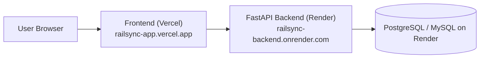

# RailSync 360 — Free Subdomain Deployment Guide

This guide walks you through hosting **RailSync 360** with 100% free subdomains on **Render** (Backend + Database) and **Vercel** (Frontend).

---

## Architecture Overview



- **Frontend Subdomain:** `https://your-app-name.vercel.app` (Free on Vercel)
- **Backend Subdomain:** `https://your-api-name.onrender.com` (Free on Render)
- **Database:** Free Managed PostgreSQL instance on Render

---

## Step 1: Push Code to GitHub

Make sure your repository has your latest code:
```bash
git add .
git commit -m "Configure production deployment blueprints for Render and Vercel"
git push origin main
```

---

## Step 2: Deploy Backend & Database on Render (Free)

1. Sign up or log into [Render.com](https://render.com).
2. Click **New +** -> **Blueprint**.
3. Connect your GitHub repository.
4. Render will automatically detect the [render.yaml](file:///c:/Users/imja3/Downloads/ADBMS%20EXP-9/render.yaml) file in your project root!
5. Render will provision:
   - **`railsync-db`**: Free PostgreSQL database.
   - **`railsync-backend`**: FastAPI web service.
   - **`railsync-worker`**: Outbox CDC worker.
6. Click **Apply Blueprint**.
7. Once deployed, copy your backend URL:
   - Example: `https://railsync-backend.onrender.com`

---

## Step 3: Deploy Frontend on Vercel (Free)

1. Sign up or log into [Vercel.com](https://vercel.com).
2. Click **Add New Project** and import your GitHub repository.
3. Configure the project settings:
   - **Root Directory:** Click `Edit` and select `frontend`.
   - **Framework Preset:** Vite (Auto-detected).
   - **Build Command:** `npm run build` (Default).
   - **Output Directory:** `dist` (Default).
4. Add an **Environment Variable**:
   - **Name:** `VITE_API_URL`
   - **Value:** `https://railsync-backend.onrender.com/api/v1` *(replace with your actual Render backend URL from Step 2)*
5. Click **Deploy**.
6. Within 60 seconds, your site will be live at:
   - **`https://<your-project>.vercel.app`**

---

## Summary of Files Prepared

- [render.yaml](file:///c:/Users/imja3/Downloads/ADBMS%20EXP-9/render.yaml): Automatic blueprint for database and FastAPI backend on Render.
- [frontend/vercel.json](file:///c:/Users/imja3/Downloads/ADBMS%20EXP-9/frontend/vercel.json): SPA rewrite configuration ensuring React Router handles all sub-paths without 404s.
- [frontend/src/services/api.ts](file:///c:/Users/imja3/Downloads/ADBMS%20EXP-9/frontend/src/services/api.ts#L3): Dynamic `VITE_API_URL` environment integration.
- [backend/requirements.txt](file:///c:/Users/imja3/Downloads/ADBMS%20EXP-9/backend/requirements.txt): Multi-database support (`pymysql` and `psycopg2-binary`).
