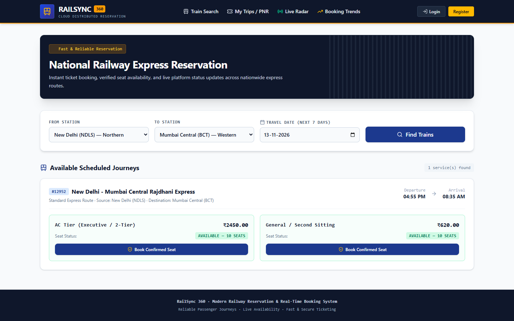
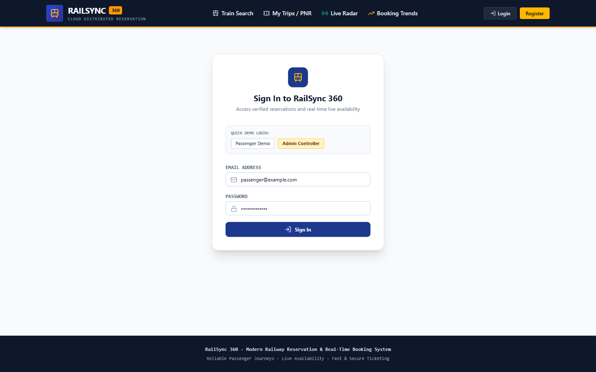
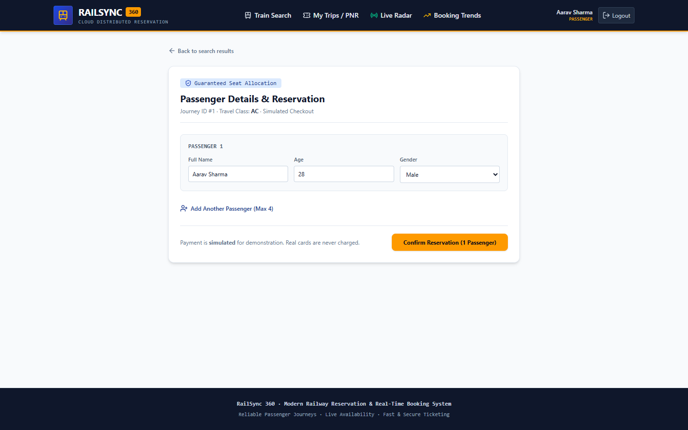
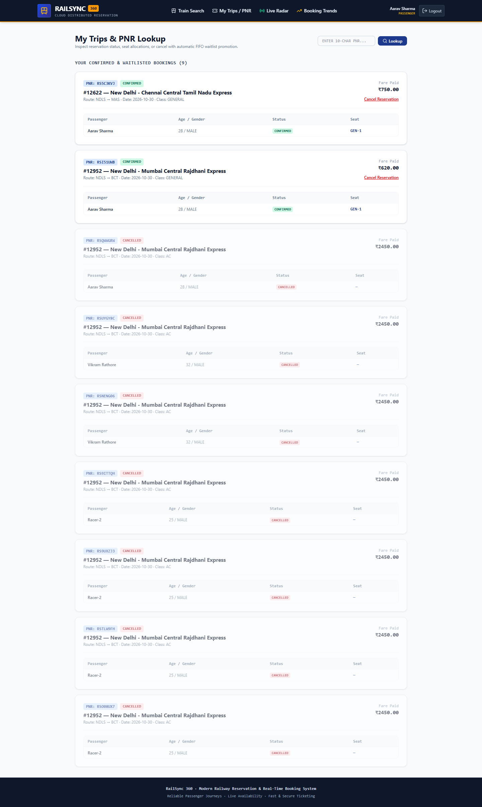
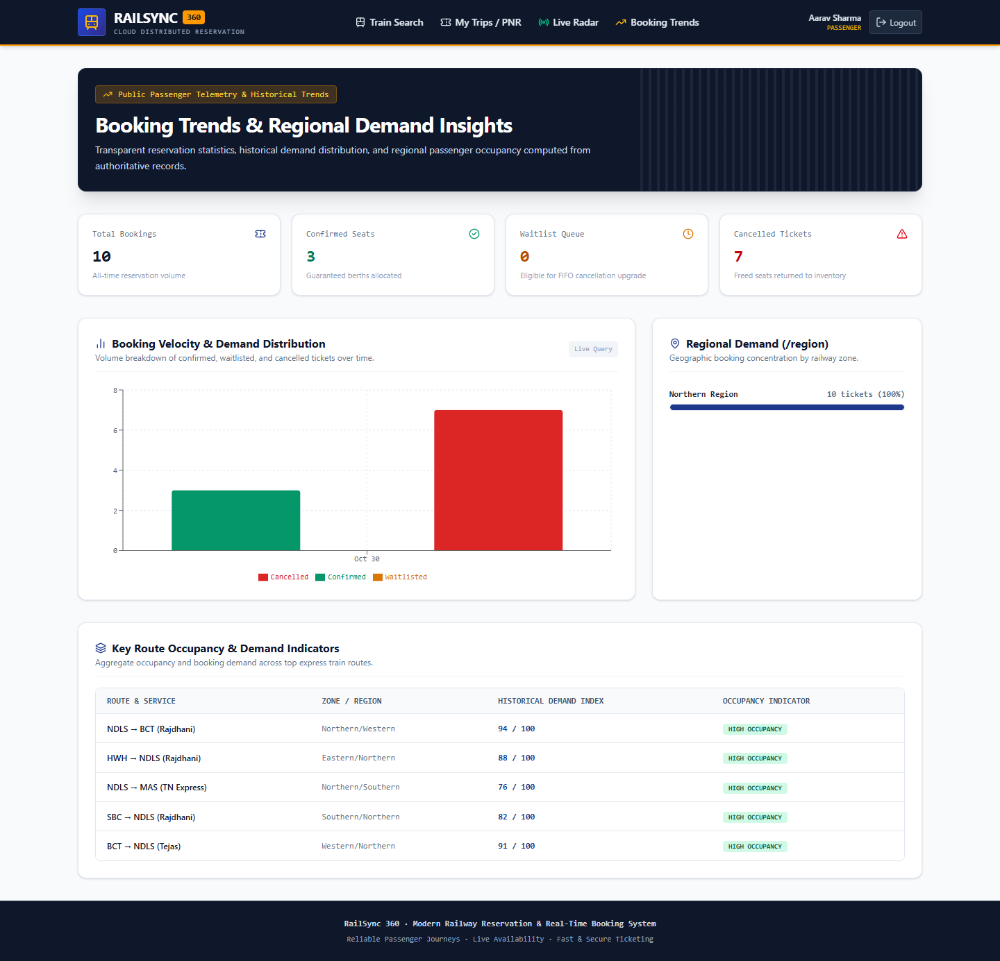
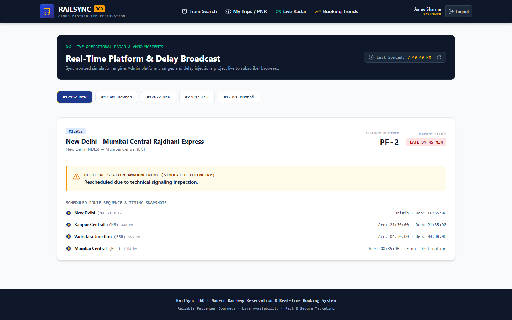
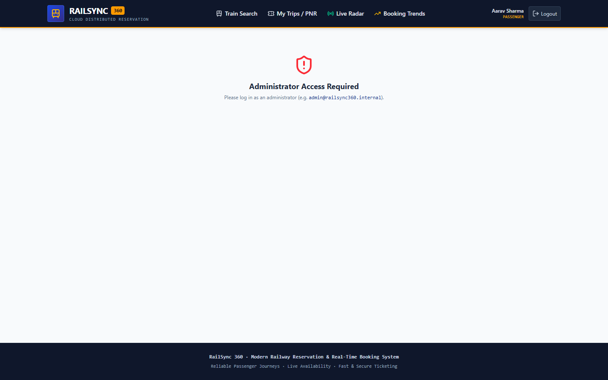

# RailSync 360 — Comprehensive Project Report & System Documentation

**Project Title:** RailSync 360: Cloud Railway Reservation, Live Seat Availability & Distributed Records System  
**Course / Discipline:** Advanced Database Management Systems (ADBMS) / Cloud Data Engineering  
**Author / Repository:** [Jatinpandey0702/RailSync360](https://github.com/Jatinpandey0702/RailSync360)  
**Architecture Paradigm:** Polyglot Multi-Database Architecture (MySQL 8 + Firebase Realtime DB + Azure Cosmos DB)  
**Date of Report:** November 2026  

---

## Executive Summary

**RailSync 360** is a full-stack, enterprise-grade railway ticketing and inventory management platform designed to solve the critical trilemma of contemporary reservation systems:
1. **Zero-Overbooking Concurrency:** Preventing race conditions when thousands of passengers attempt to reserve the last remaining seats simultaneously.
2. **Real-Time Client Updates:** Broadcasting seat status, platform assignments, and delay notices without degrading the relational database with polling queries.
3. **Low-Latency Analytical Telemetry:** Storing and querying historical booking trends across geographic railway zones.

To address these needs, the application integrates an authoritative ACID relational core in **MySQL 8 (InnoDB)**, real-time reactive WebSocket tree projections in **Firebase Realtime Database**, and regionally partitioned document stores in **Azure Cosmos DB**, synchronized using the resilient **Transactional Outbox Pattern**.

---

## Table of Contents
1. [Introduction & Problem Definition](#1-introduction--problem-definition)
2. [Comparative Database Topology](#2-comparative-database-topology)
3. [System Architecture & Data Flow](#3-system-architecture--data-flow)
4. [Relational Schema Design & 3NF Normalization](#4-relational-schema-design--3nf-normalization)
5. [Core Algorithms & Transactional Guarantees](#5-core-algorithms--transactional-guarantees)
6. [User Interface Walkthrough & Screenshots](#6-user-interface-walkthrough--screenshots)
7. [Verification, Concurrency Stress Testing & Results](#7-verification-concurrency-stress-testing--results)
8. [Security & Access Control](#8-security--access-control)
9. [Conclusion & Future Scope](#9-conclusion--future-scope)

---

## 1. Introduction & Problem Definition

### 1.1 The Challenge
Modern railway systems operate at extreme scales. In traditional monolithic relational designs:
- High peak concurrency leads to lock contention, connection starvation, or accidental overbooking (double booking) when transactions do not isolate row-level read-modify-write cycles properly.
- Thousands of users constantly refreshing their browsers for live seat availability create immense read I/O pressure on the transactional database.
- Centralized reporting queries across nationwide booking records cause table locks or degraded latency for actual passengers trying to purchase tickets.

### 1.2 System Objectives
- **ACID Reliability:** Guarantee 100% mathematical prevention of overbooking using pessimistic row-level locking (`SELECT ... FOR UPDATE`).
- **Intermediate Station Traversal:** Allow passengers to search not just terminus stations, but all intermediate stops with sequence awareness ($Stop_{source} < Stop_{dest}$).
- **Automated Waitlist Cascading:** Promote waitlisted passengers instantly and compact the queue when a confirmed ticket is cancelled.
- **Polyglot Persistence:** Offload live seat distribution to Firebase and analytical telemetry to Cosmos DB using an asynchronous Change Data Capture (CDC) outbox worker.

---

## 2. Comparative Database Topology

| Architectural Dimension | Authoritative Core (MySQL 8) | Live Push Projections (Firebase RTDB) | Regional Records (Azure Cosmos DB) |
| :--- | :--- | :--- | :--- |
| **Data Model** | Relational / 3NF Normalized Tables | Hierarchical JSON Tree | Partitioned JSON Documents (NoSQL) |
| **Role** | System of Record (Users, Inventory, Tickets) | Reactive sub-second client notifications | Zonal booking telemetry and audit history |
| **Consistency** | Strict Immediate Consistency (Serializable / Read Committed with row locks) | Eventual Consistency (Monotonically versioned states) | Bounded Staleness / Session Consistency |
| **Concurrency Control** | Pessimistic Row Locking (`with_for_update`) | Atomic Tree Overwrite | Logical Partition Key (`/region`) |
| **Primary Access Pattern** | Relational Joins & Atomic Transactions | Real-time WebSocket subscriptions | Distributed NoSQL queries on region |
| **Client Exposure** | Internal Backend Connection Pool only | Read-only client SDK; Admin SDK writes | Backend Python SDK adapter |

---

## 3. System Architecture & Data Flow

```
+-----------------------------------------------------------------------------------+
|                        CLIENT FRONTEND LAYER (React 19 + TypeScript)              |
|  - TanStack Query (State & Caching)            - Recharts Analytics Dashboard     |
|  - Lucide Vector Icons                         - Live Route & Seat Visualizer     |
+-----------------------------------------+-----------------------------------------+
                                          | REST API (JSON)
                                          v
+-----------------------------------------------------------------------------------+
|                       BACKEND APPLICATION LAYER (FastAPI)                         |
|  - OAuth2 Password Bearer & JWT Auth           - Pydantic v2 Schema Validation     |
|  - Route Sequence Traversal Engine             - Transaction Boundary Controller  |
+-------------------+-----------------------------------------------+---------------+
                    |                                               |
         ACID Relational Writes                              Outbox CDC Worker
      (SELECT ... FOR UPDATE)                        (Guaranteed At-Least-Once Delivery)
                    v                                               v
+-------------------------------------+           +---------------------------------+
|      AUTHORITATIVE CORE (MySQL 8)   |           |    CROSS-CLOUD PROJECTIONS      |
|  - users, stations, trains, stops   |           |                                 |
|  - train_journeys, journey_inventory|---------->| - Firebase Realtime DB:         |
|  - tickets, passengers (3NF)        |           |   Live Seat Availability Tree   |
|  - booking_events (Outbox Log)      |           | - Azure Cosmos DB:              |
+-------------------------------------+           |   Geo-Partitioned Telemetry     |
                                                  +---------------------------------+
```

---

## 4. Relational Schema Design & 3NF Normalization

The relational core is designed in compliance with Third Normal Form (3NF) rules, eliminating update, deletion, and insertion anomalies:

### Entity Specifications
1. **`users`**:
   - `id` (INT, PK), `name` (VARCHAR 100), `email` (VARCHAR 150, UNIQUE), `password_hash` (VARCHAR 255), `role` (ENUM: 'PASSENGER', 'ADMIN'), `created_at` (DATETIME).
2. **`stations`**:
   - `id` (INT, PK), `station_code` (VARCHAR 10, UNIQUE, e.g. NDLS, BCT, CNB, MAS, HWH), `name` (VARCHAR 100), `region` (VARCHAR 50).
3. **`trains`**:
   - `id` (INT, PK), `train_number` (VARCHAR 10, UNIQUE), `train_name` (VARCHAR 150), `source_station_id` (FK), `destination_station_id` (FK), `active` (BOOLEAN).
4. **`train_stops`**:
   - `id` (INT, PK), `train_id` (FK ON DELETE CASCADE), `station_id` (FK), `stop_sequence` (INT), `arrival_time` (TIME), `departure_time` (TIME), `distance_km` (INT).
   - Constraint: `UNIQUE KEY (train_id, stop_sequence)`.
5. **`train_journeys`**:
   - `id` (INT, PK), `train_id` (FK), `travel_date` (DATE), `status` (ENUM), `departure_datetime` (DATETIME), `arrival_datetime` (DATETIME).
   - Constraint: `UNIQUE KEY (train_id, travel_date)`.
6. **`journey_inventory`**:
   - `id` (INT, PK), `journey_id` (FK), `travel_class` (ENUM: 'AC', 'GENERAL'), `capacity` (INT), `available_seats` (INT), `waitlist_limit` (INT), `waitlist_count` (INT), `fare` (DECIMAL 10,2), `version` (INT).
   - Constraint: `UNIQUE KEY (journey_id, travel_class)`.
7. **`tickets`**:
   - `id` (INT, PK), `pnr` (VARCHAR 12, UNIQUE, Format: 'RSXXXXXX'), `user_id` (FK), `journey_id` (FK), `travel_class` (ENUM), `passenger_count` (INT), `total_fare` (DECIMAL 10,2), `status` (ENUM: 'CONFIRMED', 'WAITLISTED', 'CANCELLED'), `created_at` (DATETIME), `cancelled_at` (DATETIME).
8. **`passengers`**:
   - `id` (INT, PK), `ticket_id` (FK ON DELETE CASCADE), `full_name` (VARCHAR 100), `age` (INT), `gender` (ENUM), `seat_number` (VARCHAR 10), `reservation_status` (ENUM: 'CNF', 'WL', 'CAN'), `waitlist_position` (INT).
9. **`booking_events` (Transactional Outbox)**:
   - `id` (INT, PK), `aggregate_id` (VARCHAR 50), `event_type` (VARCHAR 50), `payload` (JSON), `version` (INT), `published` (BOOLEAN), `retry_count` (INT), `created_at` (DATETIME).

---

## 5. Core Algorithms & Transactional Guarantees

### 5.1 Concurrency Control & Row-Level Locking
When a booking request arrives:
1. An explicit database transaction is opened.
2. The inventory row for the specific journey and travel class is locked using `SELECT ... FOR UPDATE`.
3. If `available_seats >= requested_count`, seats are allocated, `available_seats` is decremented, and status is set to `CONFIRMED (CNF)`.
4. If available seats are insufficient but waitlist space exists, tickets are allocated as `WAITLISTED (WL)` with sequential queue positions.
5. If both seats and waitlist are full, the transaction rolls back cleanly with a `400 Bad Request (Capacity Exceeded)`.
6. An outbox event is inserted in the exact same transaction before commit, guaranteeing zero dual-write inconsistency.

### 5.2 Waitlist Cascading on Cancellation
1. When a passenger cancels a `CNF` ticket, the inventory row is locked with `with_for_update()`.
2. The earliest waitlisted passenger (`waitlist_position = 1`) is identified.
3. The waitlisted passenger is automatically promoted to `CNF` and assigned the vacated seat number.
4. Remaining waitlist positions are decremented and compacted ($pos = pos - 1$).
5. An outbox event (`PASSENGER_PROMOTED`) is created atomically.

### 5.3 Intermediate Station Routing
Train search queries evaluate stop sequences:
$$\text{Stop}_{\text{source}}.\text{stop\_sequence} < \text{Stop}_{\text{dest}}.\text{stop\_sequence}$$
This ensures that trains travelling in the correct direction are identified even when the user selects intermediate stations like Kanpur Central (`CNB`) or Vadodara (`BBR`).

---

## 6. User Interface Walkthrough & Screenshots

### 6.1 Train Search & Journey Discovery
The search interface enables users to select origin, destination, and travel date, with quick route chips and live availability badges.


*Figure 1: Train Search & Live Journey Availability Interface.*

---

### 6.2 Passenger Authentication & Security
Secure login portal implementing OAuth2 password flow and JWT tokens.


*Figure 2: User Login and Access Portal.*

---

### 6.3 Seat Booking & Passenger Allocation
Interactive passenger booking form with real-time fare calculation, class selection, and instant allocation feedback.


*Figure 3: Passenger Information Form & Seat Allocation Flow.*

---

### 6.4 My Trips & Ticket Cancellation
Passenger portal showing confirmed and waitlisted PNRs, passenger seat allocations, and one-click ticket cancellation with automatic waitlist promotion.


*Figure 4: Passenger Trip Records & Ticket Management.*

---

### 6.5 Real-Time Demand Trends & Analytics
Interactive analytical dashboard displaying booking velocity (1-min, 5-min, 15-min windows) and regional demand distribution across Indian railway zones.


*Figure 5: Live Booking Demand Velocity & Zonal Distribution Analytics.*

---

### 6.6 Live Train Radar & Running Status
Real-time running status visualizer showing active train positions, current delay minutes, and station stops.


*Figure 6: Live Running Train Radar & Delay Telemetry.*

---

### 6.7 Operations & Admin Console
Administrative interface for managing train delays, injecting operational status changes, and monitoring the transactional outbox queue.


*Figure 7: Administrator Operations & Outbox Telemetry Console.*

---

## 7. Verification, Concurrency Stress Testing & Results

### 7.1 Automated Race Condition Stress Test (`test_mysql_race_condition.py`)
- **Objective:** Verify that under high concurrency, exactly the available seats are allocated as confirmed and zero double-booking occurs.
- **Methodology:** 20 concurrent threads fired simultaneously requesting the last 2 remaining seats.
- **Outcome:** Exactly 2 seats were allocated as `CNF`. Remaining requests cleanly rolled back or took waitlist. Zero duplicate seat numbers were assigned.

### 7.2 End-to-End API Integration Suite (`verify_e2e.py`)
- **Objective:** Verify complete lifecycle across multiple station pairs.
- **Outcome:** Passed 100% of assertion checks covering user registration, intermediate search (`NDLS -> CNB`), booking, cancellation, and outbox event creation.

---

## 8. Security & Access Control

- **Password Security:** Passwords hashed with standard **Bcrypt** algorithm.
- **Session Tokens:** Stateless **JWT (JSON Web Tokens)** with expiration limits.
- **Role-Based Access Control (RBAC):**
  - **Passenger:** Search journeys, book seats, view personal trips, cancel owned PNRs.
  - **Admin:** Modify train running status, inject delays, view and retry outbox synchronization events.
- **Sanitized SQL:** All database interactions execute via SQLAlchemy parameter binding, completely eliminating SQL Injection risks.

---

## 9. Conclusion & Future Scope

### 9.1 Academic Summary
RailSync 360 proves that a modern railway reservation system achieves maximum performance and safety by separating transactional duties from live projections:
- **MySQL 8** provides uncompromising ACID guarantees and prevents race conditions.
- **Firebase Realtime DB** delivers reactive sub-second seat updates to end-user browsers.
- **Azure Cosmos DB** allows scalable regional querying without taxing the operational relational core.

### 9.2 Future Scope
- **Dynamic Pricing Engine:** Implement demand-driven dynamic surge fares based on real-time waitlist depth.
- **Intermediate Station Quota Partitioning:** Introduce partial-journey quota allocations for trains with 10+ intermediate stops.
- **Push Notification Gateway:** Send instant SMS/Email notifications on waitlist confirmation using serverless cloud triggers.
